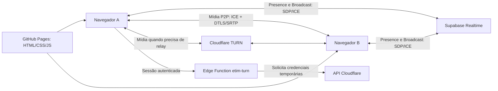

# Auditoria técnica do etim

Data: 23/10/2026. Repositório: `matarazus/etim`. Commit auditado: `9f03c9d0f436e3bc3621f39fa4fc20e04663e12c`, também confirmado como `main` remoto durante a auditoria.

**Conclusão:** há um defeito estrutural reproduzido na associação de transceivers que negocia áudio e vídeo em uma só direção. Há também classificação incorreta de câmera/tela e condições de corrida em captura, sessão e TURN. As correções anteriores de reprodução e reconexão não eliminam esses defeitos.

Não alterei `app.js`, `index.html`, `styles.css`, `config.js` ou a Edge Function. Acrescentei testes e este relatório; não fiz push, deploy, publicação no GitHub Pages, mudanças no Supabase ou chamadas autenticadas à Cloudflare. A proposta de correção principal foi exercitada como experimento isolado de SDP, sem substituir a implementação do aplicativo.

## Evidência e alcance

Foram executados **30 testes: 13 passaram, 11 falharam e 6 foram ignorados por restrição de transporte do ambiente**. As 11 falhas são asserções de comportamento correto sobre defeitos reproduzidos. Nenhuma foi convertida em “falha esperada”. Os 13 resultados positivos incluem dez testes isolados da Edge Function, saída normal, reentrada com nova sessão e um controle de negociação correta; não significam que chamadas estejam funcionando.

- [Resultado integral do runner](webrtc-baseline.tap).
- [Evidência resumida do navegador](webrtc-evidence.json).
- [Testes de navegador](../tests/webrtc/audit.test.cjs), [laboratório](../tests/webrtc/harness.cjs) e [contratos TURN](../tests/webrtc/turn.test.cjs).
- [Como reproduzir e interpretar](../tests/webrtc/README.md).

O laboratório usa o código real do aplicativo e o motor WebRTC nativo do Chromium 154, com dois ou três contextos independentes. A sinalização e a presença Supabase são simuladas para controlar ordem e atrasos. Não é um teste de integração com o Supabase implantado. A captura de tela é uma fonte animada de canvas, e câmera/microfone são dispositivos artificiais do Chromium.

O Chromium do ambiente tem `WebRtcIPHandling=disable_non_proxied_udp`: não gerou candidatos host nos testes locais. O download oficial do Chromium do Playwright foi bloqueado com HTTP 403 em `cdn.playwright.dev`. Essas políticas não foram alteradas. Portanto, **SDP, transceivers, eventos `ontrack`, captura artificial e ciclo de vida foram exercitados; tráfego RTP, decodificação ponta a ponta e conectividade TURN não foram validados**. Não se confundiu ausência de RTP causada pelo ambiente com falha de rede do aplicativo.

Não há Safari real neste Linux; Playwright WebKit também não estava instalado. Nenhuma afirmação de aprovação em Safari/iPhone é feita. Tampouco foi verificado se os arquivos efetivamente publicados no GitHub Pages são exatamente esse commit — é necessário comparar o artefato servido e o cache nos aparelhos afetados.

## Arquitetura atual



GitHub Pages apenas entrega os arquivos. Supabase Realtime transporta presença e sinalização; não transporta o áudio/vídeo. TURN retransmite pacotes quando necessário; não corrige direções SDP, senders desconectados ou players associados à faixa errada. Cada participante cria um `RTCPeerConnection` para cada outro participante: topologia mesh.

## F1 — Crítico: transceivers do lado que responde não são negociados

**Confirmado no código e no navegador nativo.** Referências: `app.js:596` (`ensurePeer`), `app.js:680` (`offerPeer`) e `app.js:756` (processamento de oferta).

Ambos os lados executam `addTransceiver('audio')`, `addTransceiver('video')`, `addTransceiver('video')` antes da primeira oferta. Seus senders recebem as faixas locais com `replaceTrack`. Isso funciona para quem cria a oferta. Entretanto, ao aplicar uma oferta remota, transceivers não associados criados por **`addTransceiver` não são automaticamente reutilizados** para as seções da oferta. O navegador cria outros transceivers para recebê-las. Essa diferença em relação a `addTrack` é explícita na especificação W3C, seção “RTCRtpTransceiver”.

Resultado observado:

| Lado | Transceiver | MID | `direction` | `currentDirection` | Consequência |
|---|---|---|---|---|---|
| Ofertante | áudio/câmera/tela | 0/1/2 | sendrecv | sendonly | Envia; não negocia recepção |
| Respondente | três criados pelo app | null | sendrecv | null | Track local pode estar `live`, mas não transmite no SDP |
| Respondente | três criados ao receber oferta | 0/1/2 | recvonly | recvonly | Recebe; seus senders não são os guardados pelo app |

No teste, a resposta contém três linhas `a=recvonly`, e o respondente possui **seis transceivers**. A faixa do microfone está `live` no sender órfão. Reabrir permissões, habilitar o microfone, chamar `replaceTrack` novamente ou `audio.play()` não conecta esse sender à seção SDP correta.

O iniciador é escolhido por `myId() < id`, não explicitamente pela ordem de entrada. Os testes nas duas ordens A→B e B→A produziram a mesma falha determinada pelos IDs. O relato de prioridade para quem chega primeiro continua relevante para corridas de presença/TURN; **não foi reproduzida uma inversão causada só pela ordem de entrada**. IDs persistentes/diferentes entre navegadores e versões publicadas também precisam ser correlacionados antes de explicar essa observação.

**Proposta:** apenas o ofertante cria os três slots iniciais. O respondente aplica a oferta e associa seus papéis aos transceivers efetivamente oferecidos, ajusta `direction='sendrecv'`, substitui as tracks nos senders desses transceivers e só então cria a resposta. Guardar associação explícita `papel → MID → transceiver`. Em `ontrack`, usar essa associação, inclusive quando o evento ocorrer durante `setRemoteDescription`; o manifesto de MIDs deve estar disponível antes ou os eventos devem aguardar a associação.

O teste de controle desse desenho resultou em três transceivers com MID e `currentDirection='sendrecv'` nos dois lados. Isso valida o princípio, não uma correção completa no app nem RTP real. Não recomendo trocar mecanicamente todas as chamadas por `addTrack`: câmera e tela do mesmo tipo precisam continuar distinguíveis, e a mudança isolada não resolve as outras corridas.

## F2 — Crítico: câmera e tela recebidas sobrescrevem o mesmo registro

**Confirmado por `ontrack` real.** Referência: `app.js:640`.

O teste `ev.transceiver === screenTrans` ou `ev.transceiver.mid === screenTrans.mid` usa o `screenTrans` criado localmente. No respondente, ele continua com `mid=null`, enquanto a tela recebida pertence ao novo transceiver de MID 2. A comparação falha; os dois vídeos entram em `state.remoteCameras.set(id, info)`.

Depois da negociação, o estado observado no respondente foi:

```text
remoteCameras = [{ id: "a", mid: "2", active: false }]
remoteScreens = []
```

O receiver da câmera de MID 1 foi sobrescrito pelo receiver reservado à tela, mesmo sem compartilhamento ativo. Isso explica um caminho concreto para ausência de imagem/câmera associada a uma faixa sem quadros. Quando a tela transmite, ela pode acabar no espaço da câmera. A correspondência exata com o quadrado preto no Safari físico ainda precisa de RTP e vídeo dos aparelhos; a perda da associação já está comprovada.

**Proposta:** identidade estável por peer + papel/MID; dois receivers de vídeo não podem sobrescrever um slot. A condição `track.muted` é transporte temporariamente sem dados, não identidade nem intenção de publicação. Manter o player e diferenciar `publicado`, `recebendo`, `decodificando` e `reproduzindo`.

## F3 — Alto: Presence inicia ICE antes de carregar TURN

**Confirmado pelo teste de ordem de inicialização.** Referências: `app.js:355`, `app.js:538`, `app.js:598`.

`joinVoice` publica a presença antes de `await loadTurnServers()`. O callback de `presence.sync` e mensagens `hello`/`offer` podem executar `syncPeers`/`ensurePeer` durante esse intervalo. O peer é criado com `turnServers=[]`. Carregar a variável global depois não altera a configuração daquele `RTCPeerConnection`; não há `setConfiguration` nem `restartIce` nesse fluxo.

O teste atrasou a resposta TURN e observou um peer criado antes da resolução. Assim, “credenciais TURN carregadas: sim” no diagnóstico não prova que o peer atual tenha TURN configurado, muito menos que esteja usando relay. Essa corrida pode depender da ordem de chegada e só aparecer nas redes em que STUN direto falha.

**Proposta:** estabelecer um estado de prontidão da sessão (captura + configuração ICE) antes de permitir criação de peers ou processar ofertas. Ofertas recebidas durante inicialização devem aguardar. Se optar por iniciar diretamente, atualizar explicitamente a configuração dos peers e negociar um ICE restart quando o TURN chegar. Não recriar todos os peers apenas para “tentar de novo”.

Adicionar teste de integração com `iceTransportPolicy:'relay'`, verificando `selectedCandidatePairId`, candidato `relay`, RTP em ambas as direções e reconexão. Isso exige credenciais temporárias de um projeto de teste, não segredos de produção no repositório.

## F4 — Alto: permissões assíncronas não pertencem a uma sessão de mídia

**Três casos reproduzidos.** Referências: `app.js:1060`, `app.js:1097`, `app.js:1116`.

1. **Tela após sair:** `startScreen` espera `getDisplayMedia` e publica a captura sem conferir se ainda está na sala. Ao sair antes da resposta do seletor, a nova track permanece `live` fora da sala.
2. **Câmera na sala errada:** `startCamera` confere apenas se existe alguma sala. Ao iniciar na sala X, sair, entrar em Y e resolver a permissão, a captura antiga é atribuída a Y. O teste observou a track ainda `live`.
3. **Mute durante recuperação:** `repairMicrophone` começa enquanto `state.muted=false`, aguarda a captura e não reaplica o mute atual. Se o usuário silencia enquanto espera, a UI continua silenciada, mas a nova track fica `enabled=true`. O teste reproduziu essa divergência; não foi necessário transmitir áudio real para demonstrá-la.

Também faltam exclusão/identificadores de operação para cliques concorrentes em câmera/tela. Duas capturas simultâneas podem substituir referências sem encerrar a anterior; esse último caso é risco de código, sem teste específico nesta rodada.

**Proposta:** usar token de sessão + geração da operação para cada captura; revalidar após cada `await`. Ao resolver uma operação cancelada, parar todas as tracks retornadas. Antes de anexar microfone, definir `newTrack.enabled = !state.muted`. Serializar início/parada/substituição e aplicar os resultados individualmente aos peers ainda pertencentes à sessão. Não encerrar a track anterior e anunciar sucesso antes de conferir os resultados de `replaceTrack`.

## F5 — Alto: sinalização enfileirada pode entrar na sessão seguinte

**Reproduzido com saída e entrada em outra sala.** Referências: `app.js:722`, `app.js:730`, `app.js:552`.

`queueSignal` verifica sala e `toSession` antes de colocar a mensagem na fila. `handleSignal` não repete essas verificações ao executá-la. Limpar `state.signalTasks` não cancela promessas já encadeadas. No teste, uma oferta ficou atrás de uma operação pendente; o usuário saiu, entrou em outra sala, e a oferta antiga criou um peer na sessão nova.

Além disso, `p.session` (sessão do remetente) é enviado mas não validado contra o participante esperado, e `roomRemoteIds` não garante a identidade/autenticidade de `p.from`. Uma sala Supabase privada autentica acesso ao canal; isso não prova por si só que cada campo de payload pertence ao usuário autenticado. Sem as políticas do backend, não é possível confirmar o isolamento de sinalização.

**Proposta:** validar sala, sessão local, sessão remota, peer/generation e tipo de mensagem no início da execução e depois de operações assíncronas. Cada peer precisa de fila cancelável por geração. Definir o protocolo e a autorização da identidade remetente; ignorar participantes que não pertencem à sessão/sala esperada.

## F6 — Alto: transações SDP/ICE não têm recuperação completa

**Análise de código; a reprodução com perda de resposta depende de RTP e ficou pendente.** Referências: `app.js:488`, `app.js:588`, `app.js:680`, `app.js:703`, `app.js:730`, `app.js:865`.

- `signal` apenas registra aviso se o Broadcast falha; não retorna uma falha tratável à transação. ACK do servidor não significa que o destinatário aplicou o SDP.
- Um peer já `connected` é ignorado pelo watchdog. Se uma resposta de renegociação se perde, o peer pode continuar `have-local-offer` e nunca sair desse estado. Pedidos seguintes viram `pendingMediaOffer`, mas dependem da resposta perdida para prosseguir.
- `connectionId` muda a cada oferta, embora a geração ICE possa ser a mesma. Candidatos tardios de uma negociação anterior podem continuar válidos para o mesmo ufrag, mas ser descartados por ID. Um candidato da próxima negociação, chegando antes da oferta em um peer com ID anterior, também pode ser descartado em vez de enfileirado.
- `recoverPeer` recria a conexão do ofertante, mas não coordena explicitamente uma nova geração de `RTCPeerConnection` nos dois lados. `reset`, renegociação e ICE restart são conceitos distintos, hoje parcialmente misturados.
- Não há `onnegotiationneeded`, rollback ou implementação completa de perfect negotiation. Isso não é automaticamente um bug: eleição de ofertante único pode ser válida, desde que todas as mudanças e falhas tenham uma máquina de estados e fila coerentes. Aqui há caminhos paralelos fora dessa coordenação.

**Proposta:** transações com número de sequência, confirmação de aplicação, timeout, retransmissão idempotente e cancelamento por sessão. Separar `peerGeneration`, `negotiationId` e geração ICE (`usernameFragment`). Duplicatas devem poder reenviar uma resposta em cache, sem destruir mídia. Usar `restartIce()` para recuperar conectividade quando apropriado. Escolher entre ofertante único bem especificado e perfect negotiation; não misturar os dois informalmente.

## F7 — Diagnóstico pode medir o receiver errado

**Consequência direta dos transceivers órfãos, confirmada no snapshot.** Referências: `app.js:883`, `app.js:898`, `app.js:959`.

`readVoiceStatistics` acha o receiver pelo transceiver cujo sender é `peer.audioSender`. No respondente, esse transceiver é órfão; o áudio recebido por `ontrack` vem de outro receiver. Portanto, “sem estatísticas”/zero no diagnóstico pode não representar a faixa tocada. O mesmo vale para câmera e tela. A comparação de duas amostras também usa índice da lista de peers, que pode mudar entre entradas/saídas.

**Proposta:** coletar estatísticas dos senders e receivers efetivamente vinculados aos papéis e à geração. Comparar amostras por identificador estável da conexão e SSRC/ID de stats; resetar baseline após troca. Separar:

1. Captura: track existente, `readyState`, `enabled`, `muted`, configurações e energia local.
2. Envio: MID/direção, `packetsSent`, `bytesSent`, `framesEncoded`, codec e limitação de qualidade.
3. Rede: par ICE selecionado, tipo local/remoto, relay, RTT e perdas.
4. Recepção: `packetsReceived`, `framesDecoded`, energia de áudio e perdas/concealment.
5. Reprodução: `paused`, `readyState`, dimensões, erro de `play()`, `AudioContext.state` e quadros apresentados.

Não registrar SDP integral, candidatos/IPs ou credenciais TURN em telemetria comum. Os IDs nos artefatos desta auditoria são apenas participantes e sessões artificiais do laboratório.

## Safari, permissões, áudio e codecs

O problema principal não exige uma peculiaridade do Safari: foi reproduzido no Chromium com o comportamento definido pela especificação. Isso não elimina problemas adicionais específicos de iOS/macOS.

Aspectos corretos a preservar:

- `playsinline`, vídeos mutados e áudio separado reduzem conflitos de reprodução.
- `MediaStream([track])` no `ontrack` trata corretamente tracks sem `streams[0]`; a ausência de `setStreams()` não é, por si só, a causa do áudio unidirecional.
- Preservar os elementos de vídeo entre atualizações de Presence evita interromper o player desnecessariamente.
- O botão “Ativar som” trata uma recusa real de autoplay, mas só ajuda quando já existe áudio recebido.
- O app não faz munging arbitrário de SDP nem força um codec incompatível.

Pontos ainda a validar em aparelhos:

- `getUserMedia` exige contexto seguro e permissão. Pages fornece HTTPS; permissões por origem, microfone ocupado e suspensão por troca de aplicativo precisam ser observados separadamente de SDP.
- `AudioContext.resume()` e `audio.play()` podem exigir gesto do usuário. Retomar um contexto usado para indicadores não garante que todos os elementos de áudio estejam desbloqueados. Os testes automatizados liberam autoplay e não validam essas políticas reais.
- Safari pode suspender captura/reprodução em segundo plano. O timer de reparo por `track.muted` pode tentar abrir outra captura durante uma interrupção transitória; medir eventos e evitar recuperação agressiva concorrente.
- O `visibilitychange` atual retenta os vídeos, não explicitamente os áudios; `pageshow` após `pagehide` não restaura automaticamente uma chamada encerrada. Definir claramente se retornar deve reconectar ou mostrar “fora da sala”.
- VP8/H.264/Opus devem ser negociados pelo navegador. Não há evidência para forçar H.264 ou remover VP8. Primeiro distinguir “nenhum RTP”, “RTP sem frames decodificados” e “frames decodificados sem apresentação”, registrando o codec realmente escolhido.
- `getDisplayMedia({audio:false})` desativa intencionalmente áudio de sistema. O áudio de conversa usa o microfone separado. Se “áudio da tela” for desejado, é outro requisito com suporte diferente por sistema/navegador.
- Safari/iOS e Chrome/iOS não devem ser tratados como equivalentes a Safari/macOS e Chrome desktop. Registrar SO, versão e motor efetivo; o regex do diagnóstico não substitui esses dados.

## Supabase e Cloudflare TURN

Os dez testes do corpo da Edge Function passaram: método inválido, falta de identidade, falta de associação ao grupo, erro de banco, secrets ausentes, erro/timeout upstream, listas inválidas e resposta de sucesso com TTL/`no-store`. A autenticação e o acesso ao banco são simulados nesses testes.

`ctx.userClaims.id` é compatível com a API publicada de `@supabase/server` 1.9.2, consultada via pacote oficial npm durante a auditoria. Não há fundamento para substituí-lo por `sub` sem considerar que `userClaims` e `jwtClaims` são interfaces diferentes. A função já verifica associação ao clube e mantém a chave privada fora do cliente — preservar isso.

Não foram verificadas no serviço implantado: configuração JWT da função, CORS do wrapper, RLS de `club_members`, autorização do canal privado, instalação efetiva da função, secrets Cloudflare e alocação TURN real. O repositório não contém migrations, `supabase.sql` referenciado pela UI ou configuração suficiente para reconstruir todo esse backend. Ausência no Git não prova ausência no servidor, mas impede auditoria/reprodução completa.

O frontend considera TURN configurado pela variável global, não pela configuração/rota do peer. Credenciais retornadas valem 24 horas; o cache local é limitado a uma hora, mas refresh e aplicação a peers existentes precisam de desenho explícito para chamadas longas/reconexões. `@supabase/server@^1` e a CDN `supabase-js@2` não fixam artefatos exatos, dificultando correlacionar uma implantação com o que foi testado.

Para integração, usar projeto de teste com dois/três usuários, RLS equivalente e credenciais TURN temporárias; exercitar UDP, TCP/TLS disponibilizados pelo serviço e modo relay forçado. Verificar também rate limits/quotas e comportamento quando a função retorna 401/403/503. Carregar uma lista de servidores não comprova conectividade.

## Por que as correções anteriores não resolveram

O histórico mostra intervenções em autoplay, preservação do DOM, ICE precoce, reconexão, captura e diagnósticos (`635b65f`, `1ca2d5f`, `8b3bb2e`, `80606c7`, `7a0198a`, `462398a`, `a11a37b`). Algumas corrigem problemas reais. Entretanto, a criação simétrica dos transceivers e a associação errada dos receivers continuam presentes no commit auditado.

Recriar conexões, renovar microfone ou oferecer SDP novamente reaplica as mesmas associações incorretas. Ajustes de player não fazem um sender órfão transmitir. Essa é a razão técnica para priorizar negociação e identidade de mídia antes de novas tentativas automáticas.

## Alternativas de arquitetura e custos

O mesh pode funcionar para grupos pequenos, mas esta implementação não está confiável. Não é necessário trocar GitHub Pages ou Supabase para corrigir isso. Há duas decisões distintas: reparar a máquina de estados atual e decidir quanto código de mídia a equipe deseja manter.

| Opção | Benefícios | Custos e limites |
|---|---|---|
| Mesh corrigido | Preserva infraestrutura, controle do protocolo e tráfego direto quando possível | Manter negociação, sessões, recuperação e testes entre navegadores; upload e encoders crescem com participantes; TURN continua necessário |
| SFU com SDK maduro, como LiveKit Cloud | SDK coordena publicações/assinaturas/reconexão; reduz responsabilidade de SDP na aplicação; upload menos dependente do número de ouvintes | Migração, token de acesso emitido no backend, cobrança de serviço/tráfego e dependência do fornecedor; Safari e permissões ainda precisam de testes |
| LiveKit hospedado pela equipe | Controle de operação, regiões e custos de infraestrutura | Operar UDP/TCP/TLS, TURN, certificados, observabilidade, atualizações e capacidade; disponibilidade passa a ser responsabilidade da equipe |
| Cloudflare Realtime SFU | Pode aproveitar fornecedor atual e topologia SFU | TURN existente não se converte automaticamente em SFU; avaliar APIs/SDK e trabalho restante de sessões, tracks, assinaturas e reconexão antes de escolher |

Em mesh, se cada participante publica taxa total `R`, seu upload aproximado é `(N−1)×R`; o total publicado pelos N participantes é `N×(N−1)×R`. Uma SFU recebe a publicação de cada participante e encaminha as assinaturas; simulcast pode adicionar camadas, e o download depende do que cada usuário assiste.

Exemplo apenas de dimensionamento: quatro pessoas publicando 1 Mbit/s cada geram aproximadamente 12 Mbit/s de envios no mesh. Uma SFU recebe cerca de 4 Mbit/s antes de camadas adicionais e encaminha até 12 Mbit/s se todos assistirem a todos. **1 Mbit/s contínuo corresponde a aproximadamente 0,45 GB por hora.** Isso não é cotação: modelos de cobrança podem usar minutos de participante, egress e franquias. Não foram consultados preços vigentes nesta auditoria.

Minha recomendação: para estabilizar um grupo pequeno, corrigir os contratos comprovadamente quebrados e completar a matriz de testes antes de trocar tudo. Se chamadas com câmera/tela e múltiplos participantes forem uma função central do produto, preferir um SDK de SFU maduro em uma prova de conceito isolada. Manter Supabase para autenticação/chat e adicionar emissão de tokens de mídia no backend; nenhuma chave de assinatura no Pages.

## Plano de correção e critérios de liberação

1. **Negociação e identidade:** separar inicialização ofertante/respondente; mapear papéis/MIDs; corrigir senders, receivers e diagnósticos juntos. Fazer passar testes de três transceivers, duas ordens de entrada e câmera/tela separadas.
2. **Sessão e concorrência:** prontidão ICE/TURN, tokens de captura, fila por geração, invalidação de sinais antigos e mute preservado. Fazer passar testes de permissões atrasadas e sala seguinte.
3. **Recuperação:** transações SDP com timeout/ACK de aplicação e geração ICE explícita; definir quando reiniciar ICE e quando reconstruir um peer. Testar perda, duplicação e reordenação sem derrubar peers saudáveis.
4. **Validação de mídia:** executar os seis testes RTP hoje bloqueados, ampliar verificação de incremento entre duas amostras, energia de áudio e apresentação de frames. Testar câmera/tela em ambos os papéis e desligar/religar sem interromper microfone.
5. **Integração e aparelhos:** projeto Supabase de teste, TURN real/relay forçado e matriz abaixo. Só depois preparar uma implantação revisável, comparar hash dos assets e executar smoke test em staging. A suíte atual vermelha impede afirmar que está pronto para produção.

| Dimensão | Casos necessários |
|---|---|
| Navegadores | Safari macOS ↔ Chrome desktop; Safari iPhone ↔ Chrome desktop; Safari ↔ Safari; terceiro participante |
| Ordem e identidade | A entra primeiro/B entra primeiro; IDs eleitos invertidos; sessão persistente e sessão nova |
| Mídia | Voz bidirecional; mute/unmute; câmera tardia em ambos os lados; câmera + tela simultâneas; desligar/religar câmera; parar tela pelo seletor do SO |
| Ciclo de vida | Sair/reentrar; trocar sala durante permissão; revogar permissão; desconectar dispositivo; suspender/retomar aba/aplicativo |
| Rede | Mesma LAN; redes diferentes; celular; NAT restritivo; relay forçado; perda/reordenação de sinalização; troca de rede |
| Duração/carga | Chamada prolongada, renovação de credenciais, 3–4 participantes com mídia simultânea e medição de CPU/upload |

Para aprovação: nenhum sender ativo sem MID; direções compatíveis com intenção de envio; áudio com energia/RTP em ambos os sentidos; frames decodificados e apresentados nas duas fontes de vídeo; tracks encerradas ao sair; mute respeitado em recuperações; rota relay comprovada quando forçada; nenhuma publicação em sala anterior/seguinte por sinal atrasado. Conexão `connected`, porta aberta ou `play()` resolvido isoladamente não bastam.

## Fontes e verificações

- [Especificação WebRTC, modelo RTP](https://www.w3.org/TR/webrtc/#rtp-media-api): o texto foi consultado no [repositório oficial W3C](https://github.com/w3c/webrtc-pc/blob/main/webrtc.html), incluindo a distinção entre transceivers criados por `addTrack` e `addTransceiver`. O acesso direto ao domínio W3C estava bloqueado.
- Documentação oficial de `@supabase/server` 1.9.2, arquivo `docs/getting-started.md` distribuído no [pacote npm](https://www.npmjs.com/package/@supabase/server): consultada para `userClaims`, RLS e wrapper. Isso não identifica a versão efetivamente implantada da função com `^1`.
- Referências para a validação complementar: [políticas de vídeo WebKit](https://webkit.org/blog/6784/new-video-policies-for-ios/), [WebRTC no WebKit](https://webkit.org/blog/7763/a-closer-look-into-webrtc/) e [Cloudflare TURN](https://developers.cloudflare.com/realtime/turn/). Esses domínios não puderam ser consultados nesta máquina; não foram usados para afirmar aprovação ou comportamento atual dos aparelhos.

Ainda faltam os modelos/versões exatos dos aparelhos, os diagnósticos das chamadas afetadas e a confirmação do artefato publicado. O relato de que a falha ocorre também na mesma rede e varia com entrada foi incorporado aos cenários; não foi usado como prova de uma hipótese não reproduzida.
